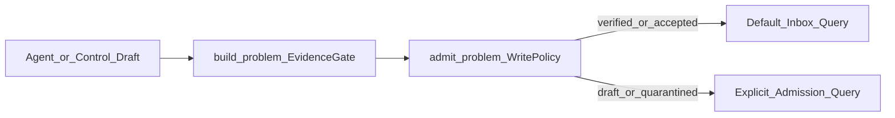

# Research Infrastructure — Phase 1 Write Policy / Admission Design

日期：2026-11-01  
状态：设计已评审（brainstorming）  
前置结论：第二轮影子实验 **Hybrid Only**（见 `evals/skill-first-pd/runs/second-round/FINAL_DECISION.md`，本地）

## 1. 目标与范围

### 1.1 本轮可实现（Phase 1）

建立 **Problem Admission（写入准入）**，与现有 **Evidence Validation（证据可信）** 分离，使外部 Agent / Skill 草稿不能在无有效证据时进入默认正式问题视图。

成功标准：

- 无有效证据的卡片 → `admission=quarantined`（保留草稿与原因，不静默删除）
- 有 ≥1 条通过 `build_problem` 的证据 → `admission=verified`
- N05：同一作者多 `source_ref` 不得仅凭 ref 数升到 E2
- 默认 `list` / `summary` / `present` 只显示 `verified|accepted`
- 不删 `discover_problems` / `assess_problems`；无 DSL；无新 Agent Runtime
- Product–Problem 关联 **本轮不做**（N09/N10 继续 N/A）

### 1.2 明确不做

- 替换现有 `ProblemStatus` 研究生命周期
- 分目录 quarantine 库（物理隔离）
- Claim 图 / 硬编码语义「核心主张是否被证据支持」
- Host Trace 自动采集（Phase 2）
- 第三真实案 / 公平对照 / 最终迁移决策实现（Phase 3–5，仅路线图）

### 1.3 已锁定决策

| 决策 | 选择 |
|------|------|
| 文档形态 | 全路线图 + 本轮只实现 Phase 1 |
| 状态模型 | `status` 与 `admission` **并列** |
| 存放与可见性 | 先 shadow 路径强制 admit → 同目录 + 默认查询过滤 |
| Product–Problem | 本轮完全不做 |
| 实现厚度 | Thin Admission Gate（方案 1） |

## 2. 架构

| 组件 | 职责 |
|------|------|
| `build_problem` | 证据可信：quote/ref/URL/等级封顶；收紧 N05 |
| `admit_problem` | 结构准入：有效证据数量 → `admission` + `admission_reason` |
| `validate_upsert` | build → admit → upsert（`--shadow` 必走） |
| `discover_problems` | 每张卡 build 后调用 admit（语义对齐） |
| Repository / CLI | 默认过滤 `verified\|accepted` |

## 3. 数据模型

### 3.1 新枚举 `Admission`

- `draft` — 宿主显式草稿（可选）
- `quarantined` — 无有效证据或结构不合格，保留可追溯
- `verified` — ≥1 条有效证据（自动）
- `accepted` — 人工确认研究价值

### 3.2 `Problem` 新增字段

- `admission: Admission`（默认：写入时由 `admit_problem` 设定；反序列化缺省按兼容策略，见 §3.4）
- `admission_reason: str` — 短机器可读原因（如 `no_valid_evidence` / `has_valid_evidence` / `human_accepted`）

### 3.3 `ProblemEvidence` 作者身份（N05）

现有 `author: str` 保留。新增可选：

- `author_id: str` — 稳定身份键；空 = 未知
- `author_identity_confidence: Literal["unknown","stated","verified"]` — 默认 `unknown`

E2 升级条件（确定性）：

- 至少两个 **不同** 的非空 `author_id`，且各自 `author_identity_confidence` ∈ `{stated, verified}`；**或**
- 至少两个 `confidence=verified` 的独立身份  

**禁止**：仅 `distinct_refs >= 2` 且 author 全空 / 同一 `author_id` → 封顶 **E1**。

### 3.4 与现有 `status` 的关系

- `status`：研究流程（`new` … `validated` / `parked` / `rejected`）**不变**
- `admission`：能否出现在默认正式 inbox  
- 旧 YAML 无 `admission`：加载时若 `evidence` 非空 → 视为 `verified`，否则 `quarantined`（一次性兼容，不改写磁盘除非下次 upsert）

### 3.5 Claim 类型（本轮）

不新增 Claim 实体。沿用：

- 事实侧 → `evidence`
- 假设 → `hypotheses`
- 未知 → `unknowns`  

Inference 暂并入 hypotheses；路线图再拆。

## 4. 准入规则

`admit_problem(problem) -> Problem`：

| 条件 | admission | admission_reason |
|------|-----------|------------------|
| 有效 evidence 为空 | `quarantined` | `no_valid_evidence` |
| 有效 evidence ≥ 1 | `verified` | `has_valid_evidence` |
| CLI 人工确认 | `accepted` | `human_accepted` |
| 可选：宿主要求草稿 | `draft` | `host_draft` |

空标题仍由 `build_problem` → `None`，不写入。

**不做**自动语义判断「证据是否支撑标题」；争议卡靠人工将 `verified` 降为 `quarantined`（后续）或 Skill 标 `draft`。

**Accepted 保护：** 已有 `admission=accepted` 的卡片，后续 upsert 不得静默降级；需 `--force`（或等价）才可改 admission。

## 5. CLI / 查询

- `list` / `summary` / `present`：默认 `admission ∈ {verified, accepted}`
- `--admission draft,quarantined,all` 显式查看隔离卡
- 最小命令：`problem-discovery admit <problem_id> --accepted`（可选 `--force`）

Shadow 与 control 共用字段；shadow 写入仍在 `problem_discovery/shadow/`。

## 6. 持久化与幂等

- 文件路径不变：`problems/<problem_id>.yaml`
- `problem_id_for(title)` 不变
- `created_at` 使用调用方传入的 `now`（已落地）
- 原子写：现有 `Workspace.atomic_write`
- Quarantined 与 Verified 可共存于同目录；靠查询过滤，不混入默认正式视图

## 7. 测试与验收

扩展负向集（本地 `evals/`，gitignored）：

| ID | 期望 |
|----|------|
| N01 | URL 覆盖；`verified` |
| N02/N03/N04/N12 | 证据丢光 → `quarantined` |
| N05 | 同作者多 ref → level ≤ e1 |
| N06/N07 | 无 e3/e4 |
| N08 | 幂等 |
| N09/N10 | N/A |
| N11 | `quarantined` |
| P01 | `verified` |
| 新增 | 默认 list 不含 quarantined |

输出（本地）：`evals/skill-first-pd/runs/phase-1/write-policy-report.json`  
仓库内单测：`tests/unit/test_problem_discovery_*.py` 覆盖 admit + N05 + list 过滤。

## 8. 最小代码触点

- `src/finch/problem_discovery/models.py`
- `src/finch/problem_discovery/discover.py`（N05 cap、`admit_problem`、discover 挂钩）
- `src/finch/problem_discovery/shadow.py`（validate_upsert）
- `src/finch/problem_discovery/repository.py` 或 list/summary 调用处过滤
- `src/finch/cli.py`（`--admission`、可选 `admit` 命令）
- 相关 unit tests

## 9. 路线图（非本轮实现）

| 阶段 | 内容 |
|------|------|
| Phase 0 | 实现前审计笔记（可附于 PR / 本地 `evals/.../phase-0-audit.md`） |
| Phase 2 | Host Trace 运行时采集；`runtime_observed` vs 人工；空结果 ≠ 失败 |
| Phase 3 | 第三真实研究案 + 故障注入 + provisional gold |
| Phase 4 | 同模型 Control vs Shadow 公平对照 |
| Phase 5 | Continue Hybrid / Limited Migration / Hold；默认不删旧编排 |

## 10. 风险

- 无语义「主张支撑」检查 → 有证据但跑题的卡仍可能 `verified`（接受，靠人工/Skill）
- control 历史卡兼容默认值可能把旧空证据卡标 quarantine — 正确行为
- Accepted 保护与 shadow 实验覆盖策略需在实现时用 flag 区分清晰
